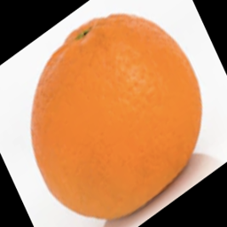
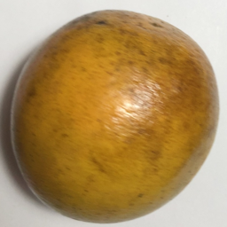
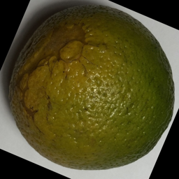
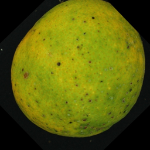
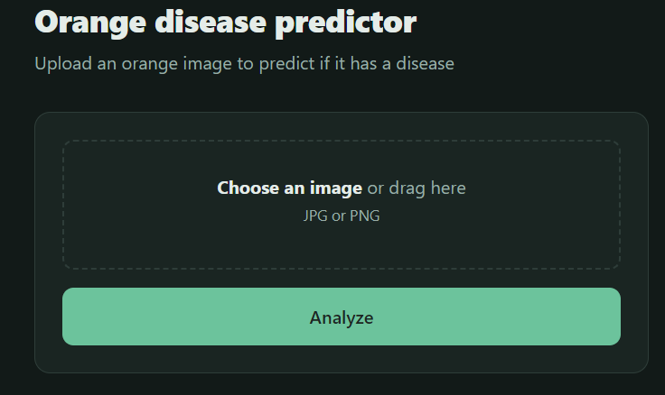
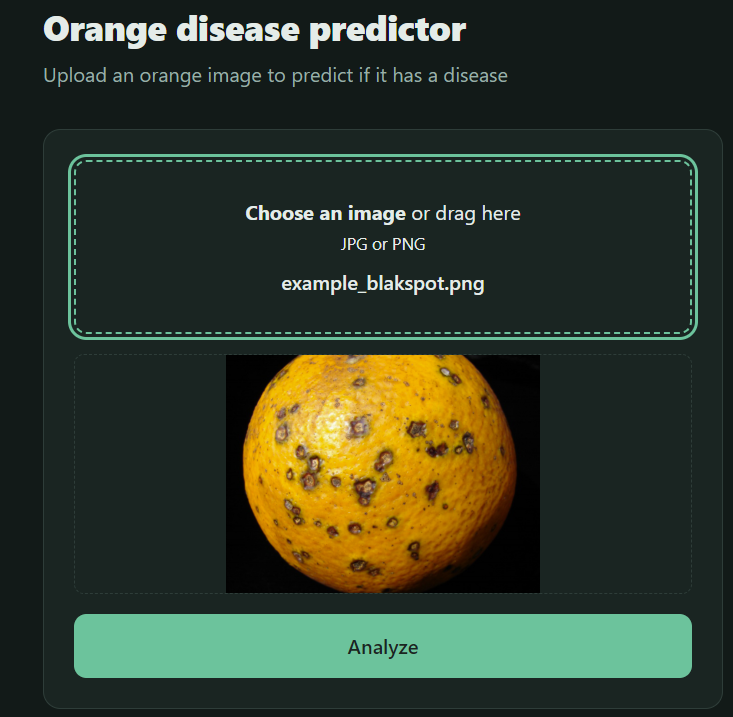
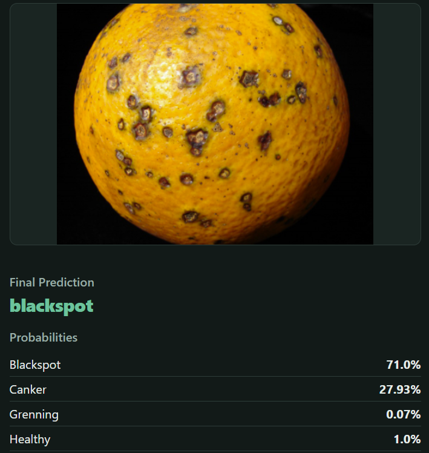

# Orange Diseases Prediction

## Problem Statement

Citrus fruits, particularly oranges, are among the most critical agricultural commodities globally. However, citrus orchards are highly susceptible to various catastrophic diseases—such as Citrus Canker, Black Spot, and Greening (HLB)—which severely impact fruit quality, reduce crop yields, and cause devastating economic losses for farmers and the agricultural industry.

The traditional approach to managing these diseases relies heavily on manual inspections by expert agronomists. This process exhibits major limitations:
* **High Costs & Scalability Issues:** Hiring specialists to physically survey large-scale orchards is expensive and difficult to scale across vast agricultural lands.
* **Delayed Detection:** Visible symptoms can easily be overlooked in their early stages by human eyes, allowing infections to spread uncontrollably to healthy trees before countermeasures can be deployed.
* **Subjectivity:** Manual diagnoses are prone to human error and misclassification, leading to either unnecessary chemical usage or inadequate treatment.

To solve these inefficiencies, this project introduces an automated **Deep Learning-based Image Classifier** trained to recognize and categorize citrus leaves/fruits into four distinct states: **three specific orange diseases and healthy crops**. 

By deploying this lightweight computer vision system, farmers can:
1. **Automate Monitoring:** Periodically scan orchards using simple mobile devices or drone imagery.
2. **Enable Early Intervention:** Detect specific disease patterns with high precision to target treatments, reducing pesticide usage.
3. **Protect Yields:** Secure food supply chains and minimize financial loss through accessible, objective, and real-time diagnostics on the field.


## EDA

- The original dataset consists of high-resolution photographs of oranges, structured into training and testing subsets. Each subset is categorized into four distinct classes corresponding to specific citrus diseases:

| Disease / Condition | Class Name | Train Images | Test Images | File Format |
| :--- | :--- | :---: | :---: | :---: |
| **Healthy Orange** | `fresh_orange` | 281 | 33 | `.png`|
| **Citrus Canker** | `cankered_orange` | 179 | 22 | `.jpg`|
| **Black Spot** | `blackspotted_orange` | 184 | 22 | `.jpg`|
| **Citrus Greening (HLB)** | `greening_orange` | 347 | 22 | `.jpg`|

- Images representing infected oranges maintain a uniform resolution of 800×800 pixels, whereas images of healthy oranges feature variable dimensions.

<p align="center">
  
  
</p>
<p align="center">
  
  
</p>
<p align="center">
  <em>Healthy orange, canker, black spot, greening</em>
</p>

- To address class imbalance, optimize storage efficiency, and accelerate model training, the original dataset was downsampled. Specifically, a random subset selection was applied to achieve a uniform distribution across categories, standardizing the final counts to 179 images for training and 22 images for testing per class.

## Modeling Approach and Metrics

### Baseline Model Architecture
For the initial baseline experiment, a **Transfer Learning** approach was implemented using a pre-trained **MobileNetV2** architecture (`IMAGENET1K_V1`). This backbone is ideal for this project due to its lightweight structure, efficiency on CPU environments, and strong feature extraction capabilities learned from millions of images.

The structural workflow consists of:
1. **Feature Extraction:** Freezing all parameters of the backbone (`base_model.parameters().requires_grad = False`) to retain the general-purpose visual representations.
2. **Dimensionality Reduction:** Replacing the native head with `nn.Identity()` and feeding the features into an `AdaptiveAvgPool2d((1, 1))` layer to get a fixed spatial dimension of 1280 features.
3. **Regularization:** Applying a `Dropout` layer with a rate of `0.2` to prevent overfitting.
4. **Classification:** Adding a custom linear output layer mapping the 1280 channels directly to the `4` distinct target categories (3 diseases + healthy oranges).

The model was compiled using the **Adam** optimizer with a baseline learning rate of `0.01` and evaluated through the **CrossEntropyLoss** criterion.

### Baseline Training Results
The model was trained for 10 epochs on CPU under strict deterministic constraints to guarantee reproducibility. The training log and performance metrics are detailed below:

| Epoch | Train Loss | Train Accuracy | Eval Loss | Eval Accuracy |
| :---: | :--------: | :------------: | :-------: | :-----------: |
| 1     | 0.5774     | 0.7877         | 0.2505    | 0.9091        |
| 2     | 0.1087     | 0.9581         | 0.1257    | 0.9432    |
| 3     | 0.1086     | 0.9679         | 0.1494    | 0.9432        |
| 4     | 0.0985     | 0.9679         | 0.1786    | 0.9318        |
| 5     | 0.0681     | 0.9791         | 0.1474    | **0.9545**    |
| 6     | 0.0958     | 0.9693         | 0.1510    | 0.9545        |
| 7     | 0.0915     | 0.9749         | 0.1625    | 0.9545        |
| 8     | 0.0725     | 0.9791         | 0.1695    | 0.9545        |
| 9     | 0.0573     | 0.9804         | 0.2515    | 0.9432        |
| 10    | 0.0558     | 0.9860         | 0.3421    | 0.8864        |

### Performance Analysis
* **Rapid Convergence:** The model benefited drastically from the pre-trained ImageNet weights, scaling from a `0.9091` evaluation accuracy in the first epoch to **`0.9545` by Epoch 5**. 
* **Best Model Checkpoint:** The peak generalization performance was achieved at **Epoch 5**, reaching an **Evaluation Accuracy of 95.45%** and an Evaluation Loss of `0.1474`.
* **Late Training Instability:** During the final epochs (Epoch 9 and 10), the training loss kept decreasing smoothly towards `0.0558`, but the evaluation loss spiked significantly up to `0.3421`, causing the validation accuracy to drop to `0.8864`. This optimization pattern indicates convergence bouncing caused by a high baseline learning rate (`lr=0.01`).

### Hyperparameter Tuning
To improve stability and further reduce validation errors, the next iteration will focus on hyperparameter tuning experiments covering:
* Reducing the learning rate to stabilize weights optimization.
* Testing a custom inner linear layer architecture (`size_inner`) vs this native baseline.
* Adjusting the dropout rate to control late-stage variance.
* Data augmentation

All experiments were executed under strict deterministic conditions (`SEED = 42`) to isolate the exact impact of each parameter.

#### Phase 1: Learning Rate Tuning

* **`lr = 0.01` (Selected):** Achieved the highest peak validation performance (**97.73% Accuracy at Epoch 4**) and maintained a superior accuracy baseline across most of the training process, closing at a robust 96.59% in Epoch 10.
* **`lr = 0.001`:** Provided a highly stable flat plateau (96.59% Accuracy) during the mid-stages (Epochs 5–7), but suffered from a slower initialization curve and a localized performance drop at Epoch 4.
* **`lr = 0.0001`:** Discarded due to sub-optimal behavior. The learning rate was too slow, causing the optimizer to get trapped in local minima, leading to severe accuracy drops (below 91% at Epoch 3).

#### Phase 2: Classification Head Architecture (`size_inner`)

Using our baseline learning rate, we evaluated whether inserting an intermediate dense layer between MobileNetV2's feature extractor (1280 channels) and the output layer (4 classes) would enhance geometric pattern representation:
* **`size = 10` (Selected):** Demonstrated immediate and exceptional convergence, hitting a **96.59% validation accuracy by Epoch 2** and locking a perfectly flat, stable plateau for **6 consecutive epochs (Epochs 2 to 7)**.
* **`size = 100`:** Suffered from excessive high-variance fluctuations throughout the training cycle, dropping to a low 92% validation accuracy at Epoch 9.
* **`size = 1000`:** Showed an extremely slow convergence rate in early stages. While it eventually recovered to match the baseline in the final epochs, the massive 1000-neuron dense layer represents an unneeded computational overhead on CPU with no performance gains.

#### Phase 3: Regularization Tuning (`dropout`)

* **`dropout = 0.2` (Selected):** Provided the best structural stabilization. Following a sharp epoch 2 adjustment, it established an optimal, risk-free **validation plateau at 96.59% accuracy through Epochs 3, 4, and 5**. 
* **`dropout = 0.0`:** Operating without regularization resulted in a highly unstable "rollercoaster" learning curve, crashing down to ~91% accuracy at Epoch 8 due to batch-sensitivity. Its high peak at Epoch 10 represents high variance rather than safe generalization.
* **`dropout = 0.5`:** Discarded due to being overly restrictive. Turning off 50% of the active neurons heavily crippled early feature adaptation and generated constant, erratic accuracy fluctuations throughout the run.

#### Configuration Summary (Pre-Augmentation)
Based on empirical visualization, the optimal configuration selected to form our solid baseline before applying data augmentation consists of:

* **Learning Rate:** `0.01`
* **Inner Layer Size:** `10`
* **Dropout Rate:** `0.2`
* **Optimal Training Epoch:** **Epoch 5** (The absolute center of convergence stability across all validated parameters).

#### Phase 4: Data Augmentation Integration and Final Model Selection

To improve the baseline model's generalization capabilities and reduce semantic memorization, spatial data augmentation was introduced exclusively to the training dataset pipelines:
```python
train_transform = transforms.Compose([
    transforms.Resize((INPUT_SIZE, INPUT_SIZE), interpolation=transforms.InterpolationMode.NEAREST),
    transforms.RandomRotation(10), 
    transforms.RandomResizedCrop(INPUT_SIZE, scale=(0.9, 1.0)), 
    transforms.RandomHorizontalFlip(), 
    transforms.ToTensor(),
    transforms.Normalize(mean=MEAN, std=STD),
])
```

With the optimal architecture (`size_inner=10`, `dropout=0.2`, `lr=0.01`) and data augmentation active, the network was scaled to 20 training epochs:

* **Maximum Evaluation Accuracy:** **97.73%** achieved at **Epoch 20**.
* **Minimum Evaluation Loss:** Decreased to an optimal **0.0897**, preventing the late-stage validation error divergence observed in the pre-tuned baseline model.

#### Conclusion & Final Checkpoint Selection
Data augmentation successfully acted as a strong regularizer. It expanded the boundaries of generalization by forcing MobileNetV2 to evaluate altered leaves and fruits under rotating angles and scaling constraints. 

The checkpoint selected for final deployment is **`../results/v0.01-10-0.02-aug_20_0.977.pth`** due to its combination of peak accuracy (97.73%) and minimal validation entropy loss (`0.0897`).


## Architecture

### Dependencies

```bash
pip install numpy
pip install torch torchvision --index-url https://download.pytorch.org/whl/cpu
pip install fastapi uvicorn
pip install matplotlib
pip install onnx onnxscript
pip install onnxruntime
pip install python-multipart
```

### Model Format

To decouple the project from heavy deep learning framework dependencies and maximize inference performance in 
production, the final model was exported from PyTorch to the **Open Neural Network Exchange (ONNX)** format. Converting 
the model to ONNX provides significant engineering advantages for deployment:

* **Framework Independence:** The production environment does not require installing `torch` and `torchvision` 
(saving over 1 GB of Docker image space). Production inference depends solely on `onnxruntime` and `numpy`.
* **CPU Optimization:** ONNX Runtime automatically applies low-level optimizations (such as node fusion and constant 
folding), radically reducing inference latency on standard CPU instances.
* **Interoperability:** The resulting `.onnx` graph can be seamlessly integrated into various backend stacks.


### Project folder structure

 TODOOOOOOO

### Architecture diagram

 TODOOOOOOO

## How to run

### How to run locally

- Requirements. Make sure you have the following installed:
    - Python >=3.14
    - pip >=26.2

- Clone the repository from GitHub:
```bash
git clone https://github.com/maneldevs/orange_diseases_prediction.git
```

- Create a virtual environment:
```bash
python -m venv .venv
```

- Activate the virtual environment:
```bash
source .venv/bin/activate
```

- Install dependencies:
```bash
pip install -r requirements.txt
```S

- Be sure you are in the root directory of the project

- Run the training script:
```bash
python scripts/train.py
# Optionally, you can specify the train folder data and model paths:
# python scripts/train.py --train data_reduced/train --modelpth models/orange_diseases_model_1.pth --models/orange_diseases_model_1.onnx
```

- Run the prediction script:
```bash
python scripts/predict.py
# Optionally, you can specify the model path:
# python scripts/predict.py --image examples/example_blakspot.png --model models/orange_diseases_model_1.onnx
```

- The results will be printed to the console:
```
 Results for the image: examples/example_blakspot.png
--------------------------------------------------
  blackspot: 71.00%
  canker: 27.93%
  grenning: 0.07%
  healthy: 1.00%
--------------------------------------------------
Prediction: **blackspot** (71.00%)
```

- Start the Web Service:
```bash
python scripts/serve.py
```

- Open the Web Service in your browser:
```bash
http://localhost:7860
```




### How to run using Docker

### How to run on the Cloud

## Known limitations and next steps